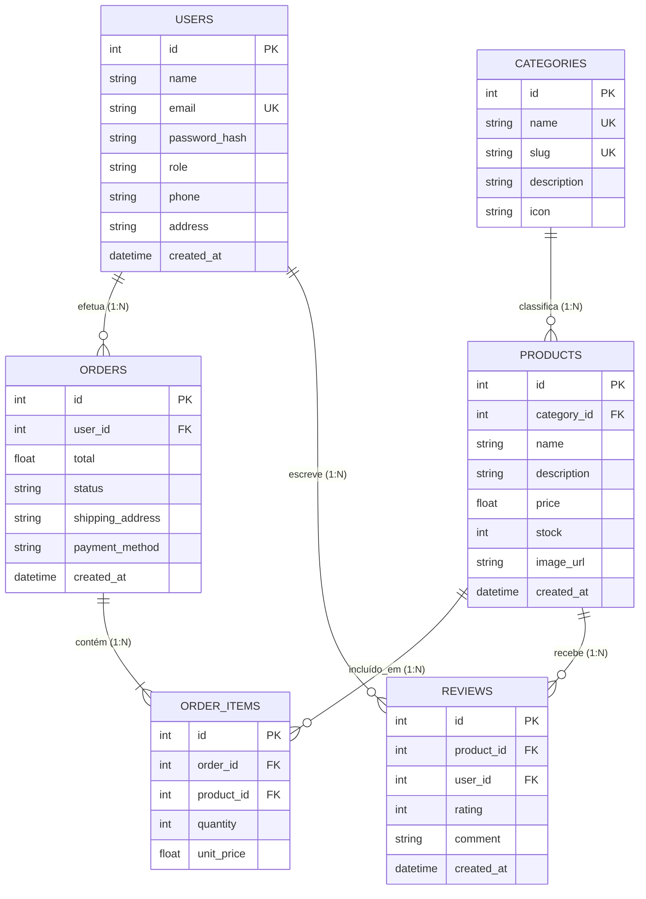

# 📚 Relatório Técnico: Sistema de Base de Dados Relacional (TechStore BD)

Este documento descreve a conceção, arquitetura lógica e física, modelo de dados relacional e implementação do sistema **TechStore BD**, desenvolvido para o trabalho prático de Base de Dados.

---

## 1. Visão Geral do Sistema

O sistema consiste numa plataforma de comércio eletrónico e gestão de inventário integrada com um Sistema de Gestão de Bases de Dados Relacionais (**SQLite 3**). O objetivo primordial é demonstrar a modelação em Terceira Forma Normal (3FN), a garantia da integridade referencial através de chaves primárias e estrangeiras, a execução de transações com propriedades ACID (Atomicidade, Consistência, Isolamento e Durabilidade) e a extração de dados analíticos através de consultas SQL avançadas.

---

## 2. Diagrama Entidade-Relacionamento (ERD)



---

## 3. Dicionário de Dados e Restrições de Integridade

### 3.1. Tabela `users`
Armazena a informação dos utilizadores (clientes e administradores). As senhas são cifradas utilizando **bcrypt com 10 salt rounds**.
- **`id`** (`INTEGER PRIMARY KEY AUTOINCREMENT`): Identificador único do utilizador.
- **`name`** (`TEXT NOT NULL`): Nome completo do utilizador.
- **`email`** (`TEXT NOT NULL UNIQUE`): Endereço de email do utilizador (chave candidata / índice único).
- **`password_hash`** (`TEXT NOT NULL`): Hash seguro da palavra-passe.
- **`role`** (`TEXT NOT NULL CHECK(role IN ('admin', 'client'))`): Nível de privilégio.

### 3.2. Tabela `categories`
Categorização temática do catálogo de produtos.
- **`id`** (`INTEGER PRIMARY KEY AUTOINCREMENT`): Identificador único.
- **`name`** (`TEXT NOT NULL UNIQUE`): Nome visível da categoria.
- **`slug`** (`TEXT NOT NULL UNIQUE`): Identificador legível para URL/filtros.

### 3.3. Tabela `products`
Catálogo de artigos para venda.
- **`id`** (`INTEGER PRIMARY KEY AUTOINCREMENT`): Identificador único do produto.
- **`category_id`** (`INTEGER NOT NULL`): Chave estrangeira que referencia `categories(id)`.
  > [!NOTE] 
  > A restrição `ON DELETE RESTRICT` impede a eliminação acidental de uma categoria enquanto existirem produtos associados a ela.
- **`price`** (`REAL NOT NULL CHECK(price >= 0)`): Preço unitário (restrição de domínio não-negativo).
- **`stock`** (`INTEGER NOT NULL DEFAULT 0 CHECK(stock >= 0)`): Controlo de unidades em armazém.

### 3.4. Tabela `orders`
Representa as encomendas finalizadas pelos utilizadores.
- **`id`** (`INTEGER PRIMARY KEY AUTOINCREMENT`): Número de encomenda.
- **`user_id`** (`INTEGER NOT NULL`): Chave estrangeira para `users(id)` com `ON DELETE CASCADE`.
- **`status`** (`TEXT NOT NULL CHECK(status IN ('pendente', 'pago', 'enviado', 'entregue', 'cancelado'))`).

### 3.5. Tabela `order_items` (Tabela de Junção N:M)
Resolve o relacionamento de muitos-para-muitos entre encomendas (`orders`) e produtos (`products`).
- **`order_id`** (`INTEGER NOT NULL`): Referência a `orders(id)` (`ON DELETE CASCADE`).
- **`product_id`** (`INTEGER NOT NULL`): Referência a `products(id)` (`ON DELETE RESTRICT`).
- **`quantity`** (`INTEGER NOT NULL CHECK(quantity > 0)`): Quantidade comprada.
- **`unit_price`** (`REAL NOT NULL CHECK(unit_price >= 0)`): Preço unitário praticado na data da venda (garante histórico imutável mesmo se o preço do produto for alterado no futuro).

### 3.6. Tabela `reviews`
Avaliações e classificações de artigos deixadas pelos clientes.
- Restrição `UNIQUE(product_id, user_id)`: Cada utilizador só pode avaliar uma dada referência uma única vez.

---

## 4. Transações ACID e Controlo de Concorrência

Para o processo de compra (`POST /api/orders`), foi implementada uma transação nativa através de `db.transaction()`:

1. **Validação de Stock:** Para cada produto no carrinho, o sistema verifica se `stock >= quantidade`.
2. **Criação da Encomenda:** Inserção do registo pai na tabela `orders`.
3. **Criação das Linhas de Artigo:** Inserção dos registos filhos na tabela `order_items`.
4. **Atualização Atómica de Inventário:** Abatimento de `stock = stock - quantidade` na tabela `products`.
5. Se qualquer falha ocorrer (e.g. stock insuficiente ou falha de integridade), é despoletado um **ROLLBACK** integral, garantindo que a base de dados nunca fica num estado inconsistente.

---

## 5. Consultas SQL Analíticas Utilizadas no Dashboard

### A. Total Faturado e Unidades Vendidas por Produto
```sql
SELECT 
    p.name AS Produto,
    c.name AS Categoria,
    p.price AS Preco_Unitario,
    COALESCE(SUM(oi.quantity), 0) AS Unidades_Vendidas,
    ROUND(COALESCE(SUM(oi.quantity * oi.unit_price), 0), 2) AS Total_Faturado
FROM products p
INNER JOIN categories c ON p.category_id = c.id
LEFT JOIN order_items oi ON p.id = oi.product_id
GROUP BY p.id
ORDER BY Unidades_Vendidas DESC;
```

### B. Rendimento e Média de Avaliações por Categoria
```sql
SELECT 
    c.name AS Categoria,
    COUNT(DISTINCT p.id) AS Qtd_Produtos,
    COUNT(r.id) AS Qtd_Avaliacoes,
    ROUND(AVG(r.rating), 2) AS Media_Classificacao
FROM categories c
LEFT JOIN products p ON c.id = p.category_id
LEFT JOIN reviews r ON p.id = r.product_id
GROUP BY c.id
ORDER BY Media_Classificacao DESC;
```
